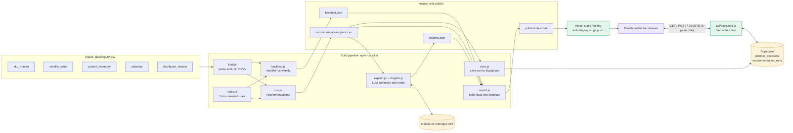
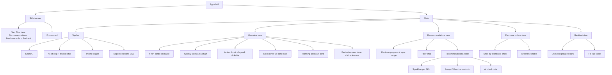

# Component map

Three layers: a **build pipeline** (Node scripts, run on demand), a **static dashboard** (one HTML page with the data baked in) and a small **server** (one Vercel function plus Supabase). The rules engine is the only thing that decides numbers; the LLM only explains them.

## 1. System overview

## 2. Pipeline modules (`src/`)

| File | Responsibility | Reads | Writes |
|---|---|---|---|
| `config.js` | Raghav's thresholds as data (20% spike, 6/14 weeks, 3/4 weeks perishable, 25% festival uplift, festival months) | none | none |
| `csv.js` | Minimal CSV read and write | files | files |
| `load.js` | Loads and joins the five input CSVs, maps ISO weeks to dates, festival lookup | `data/input/*` | in memory |
| `rules.js` | `evaluateSku()`: pure, deterministic engine. Returns action, quantity, cover, flags, plain-English reason | one SKU's data | none |
| `run.js` | Runs the engine for every SKU, sorts by urgency | `load.js`, `rules.js` | `output/recommendations.*` |
| `backtest.js` | Replays the 16 weeks under monthly (stale data) and weekly review at 0/1/2-week lead times | `load.js`, `rules.js` | `output/backtest.json` |
| `insights.js` | Builds the LLM prompt and validates the reply (JSON shape, known SKU ids, caps) | none | none |
| `explain.js` | Calls Gemini or Anthropic; retries; writes insights | recommendations, sales | `output/insights.json` |
| `report.js` | Bakes recommendations, sales, backtest and insights into the template | `output/*`, template | `public/index.html` |
| `sync.js` | Upserts the run into Supabase | recommendations | `recommendation_runs` |
| `dashboard.template.html` | The whole UI: markup, styles and client script | `__DATA__` placeholder | none |

Action outcomes from `rules.js`: `REORDER_NOW`, `REORDER_HIGH_DEMAND`, `PAUSE_ORDER`, `ON_ORDER`, `NO_ACTION`, `NEEDS_REVIEW`. Flags: `STOCKOUT_RISK`, `OVERSTOCK_RISK`, `HIGH_DEMAND`, `FESTIVAL_UPLIFT`, `RULE_CONFLICT`, `OPEN_PO_COVERS`, `NEW_LAUNCH`.

## 3. Dashboard component tree

### Render functions and the data each uses (all in the template's script)

| Function | Draws | Data source |
|---|---|---|
| `kpis()` | 4 KPI cards | `D.recs`, weekly totals |
| `salesChart()` | Sales area chart with festival bands | `D.weeks`, `D.sales` |
| `donut()` | Action donut and legend | `D.recs` |
| `coverChart()` | Cover vs target-band bars | `D.recs` |
| `insights()` | Assistant card: LLM text if present, else rules-based | `D.llm` or `D.recs` |
| `movers()` | Top movers with sparklines | `D.recs`, `D.sales` |
| `recs()` | Recommendations table, filter chip, progress | `D.recs`, decisions, `filter`, `query` |
| `po()` | Draft purchase orders by distributor | decisions, `D.recs` |
| `bt()` | Backtest chart and table | `D.backtest` |
| `spark()`, `delta()` | Shared SVG and badge helpers | n/a |

### Client state

| State | Where it lives | Notes |
|---|---|---|
| `D` | Baked into the page at build time | Recommendations, weekly sales, backtest, LLM insights |
| `dec` (decisions) | Memory, mirrored to `localStorage` and Supabase | Keyed by SKU for the current as-of date |
| `filter`, `query` | Memory | Set by clickable cards or the search box |
| `pass` | `localStorage` | Planner passcode, asked for on the first 401 |
| `remote` | Memory | True once `/api/decisions` answered; otherwise browser-only |

Interaction flows:
- **Clickable cards** (`data-filter`) go through `activate()`, which sets `filter`, calls `show('recs')` and re-renders the table.
- **Accept / Override / Undo** call `push(id)`, which saves locally, re-renders and, if `remote`, POSTs or DELETEs through the API.
- On load, `loadRemote()` fetches saved decisions and replaces local state.

## 4. Server and data

| Piece | Role |
|---|---|
| `api/decisions.js` | The only server code. GET lists, POST upserts, DELETE removes decisions for a run date. Validates dates, SKU ids, status and quantity; checks `x-passcode` with a timing-safe compare; holds the service-role key |
| `supabase/schema.sql` | `planner_decisions` (PK `as_of, sku_id`) and `recommendation_runs` (PK `as_of`, JSON payload). Row-level security on, no policies, so only the server can touch them |
| `vercel.json` | Serves `public/` as a static site; `api/` becomes the function |
| Environment | `SUPABASE_URL`, `SUPABASE_SERVICE_ROLE_KEY`, `PLANNER_PASSCODE`, `GEMINI_API_KEY` (or `ANTHROPIC_API_KEY`). In `.env` locally, Vercel env vars in production. Never in the page |

## 5. Tests (`test/`)

- `rules.test.js`: 11 tests covering each rule, the 20% boundary, festival uplift, perishable windows, open POs, new launches and rule conflicts.
- `insights.test.js`: 5 tests covering JSON extraction, dropping unknown SKU ids and tones, the bullet cap, rejecting bad replies and prompt contents.
- Not covered by automated tests: `backtest.js`, `api/decisions.js` (checked by hand against the live site), and the dashboard UI (checked by scripted clicks in the browser).

## 6. Deploy path

`git push` to `sid1935/freshroots-demand-planning` triggers a Vercel production deploy. The page is a snapshot: to refresh it, run `npm run all:ai`, commit `public/index.html`, then push.
